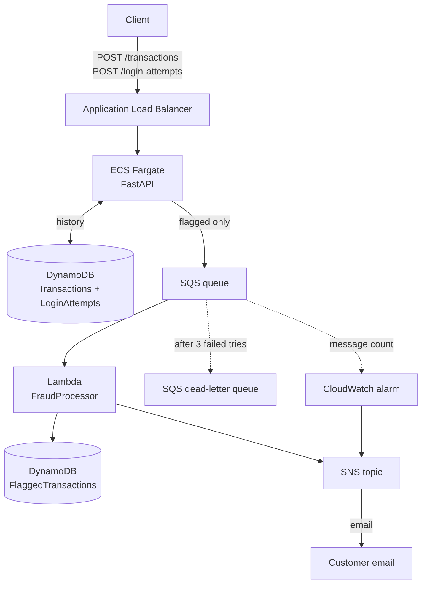

# Banking Fraud Detection and Customer Notification System

This project checks banking transactions for fraud and sends an alert when one looks suspicious. The API runs on ECS (Fargate) behind a load balancer. Flagged transactions go to an SQS queue, and a Lambda function reads the queue, saves them to DynamoDB and sends an email alert through SNS. The infrastructure is written in Python with AWS CDK.

## Architecture



When a transaction comes in, the client sends it to `POST /transactions`. Before deciding anything, the API looks up the account's last transaction and its recent failed logins in DynamoDB, since the rules need them. It then runs the fraud rules. If none of them are triggered, the transaction is marked `approved`, and if any are, it is marked `flagged`. Either way the transaction is saved and the response goes straight back to the client. Flagged ones are also sent to the SQS queue, where the Lambda picks them up, saves them in the flagged transactions table and sends the alert through SNS.

## Fraud detection logic

A transaction is flagged if any of the three rules triggers, and the response lists every reason. The numbers below are settings in `api/app/config.py`, so they can be changed with environment variables.

**Rule 1: unusually high amount.** A withdrawal or transfer over 5000 is flagged. It is a fixed maximum, so nothing needs to be stored to check it. The downside is that it flags people who often move large amounts and misses a big jump for someone who normally moves small amounts. Using each customer's own average would be better, but it needs more stored history. Deposits are not checked for amount, because a large deposit (a paycheque, a sale) is usually fine. They still go through rules 2 and 3. A real system would need its own rules for deposits.

**Rule 2: unusual location.** Each city name is matched to its coordinates, and the distance from the account's last transaction is worked out with the haversine formula. That distance is divided by 900 km/h (about a plane's speed), and 30 minutes is added for airports and delays. This gives the minimum time the trip would take. If less time than that passed between the two transactions, it is flagged. The buffer leans strict on purpose, since a flagged transaction can be reviewed but fraud that gets through is money lost. Cities that are not in the list are skipped, and the first transaction on an account has nothing to compare to.

**Rule 3: too many failed logins.** The API has no login step, so a client reports each login attempt to `POST /login-attempts`. When a transaction comes in, the API counts the failed attempts for that account in the 10 minutes before it (an attempt exactly 10 minutes before counts). If there are 3 or more, it is flagged.

Every transaction is saved, approved or not, because rule 2 needs the previous one. Only flagged ones go to the queue.

## Deploy steps

You need an AWS account, the AWS CLI logged in (`aws login`), Node.js, Python 3.11 or newer, and Docker running (CDK uses it to build the API image).

```
npm install -g aws-cdk
cd infra
pip install -r requirements.txt
cdk bootstrap
cdk deploy -c alert_email=you@example.com
```

1. When it finishes it prints `ApiUrl`. Add `/docs` to the end of it to open the API page.
2. AWS sends a confirmation email to the address you used. Click the link in it, or no alerts will arrive.
3. Send a transaction (see below). A flagged one creates a row in the flagged transactions table and sends the alert email.

`infra/cdk.json` runs `python app.py`. On Mac or Linux, change it to `python3 app.py` if `python` is not found.

To delete everything when you are done: `cdk destroy`

## API usage

The easiest way to try it is the `/docs` page, which lists the endpoints and lets you send requests from the browser. Account IDs are strings, so use quotes.

**POST /transactions**

```json
{
  "account_id": "123",
  "amount": 8000,
  "transaction_type": "transfer",
  "location": "Toronto",
  "timestamp": "2026-10-25T14:00:00Z"
}
```

`transaction_type` is `withdrawal`, `deposit` or `transfer`, and `amount` must be above 0. A timestamp with no timezone is treated as UTC.

Response (201):

```json
{
  "transaction_id": "3616f4ed-df0c-4d4a-83a5-4be8c89fded1",
  "status": "flagged",
  "reasons": ["unusually high transfer amount"],
  "alert_queued": true
}
```

`status` is `approved` or `flagged`. `alert_queued` is `null` for approved ones, and `false` if sending to the queue failed (the transaction is still saved). Bad input returns 422.

**POST /login-attempts**

```json
{ "account_id": "123", "success": false, "timestamp": "2026-10-25T13:58:00Z" }
```

Response (201): `{"recorded": true}`

**GET /health** returns `{"status": "ok"}` and is used by the load balancer health check.

Example to try rule 2: send a withdrawal from Toronto at `14:00:00Z`, then another for the same account from Vancouver at `14:10:00Z`. The second one is flagged.

## Security

- **IAM:** each part only has the permissions it needs. The API can read and write the two history tables and send to the queue. The Lambda can write to the flagged table and publish to the alert topic.
- **Network:** the load balancer is the only public entry point, and the API containers only accept traffic from it.
- **Limits:** the load balancer uses HTTP only, since HTTPS needs a domain and certificate. Alerts go to the one email set at deploy time, not to each customer's own email.
- **Bonus done:** a CloudWatch alarm that notifies the alert topic when 10 or more transactions are flagged in 5 minutes. Not done: JWT, Kinesis Firehose and multi-tenant.
